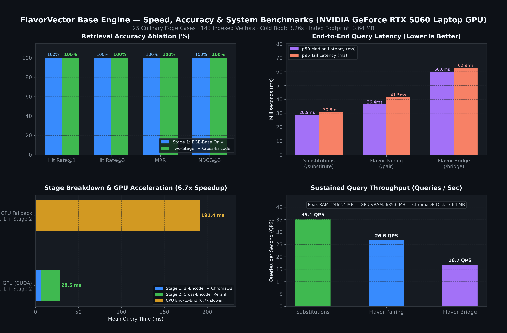
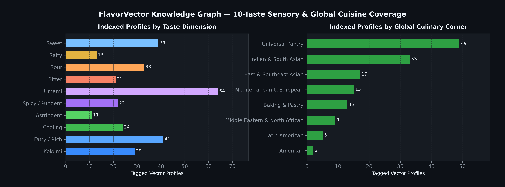

# FlavorVector





A local-first, self-expanding **Semantic Cooking Substitution & Flavor-Pairing Engine** powered by food-science chemistry, volatile aroma compounds, and two-stage neural retrieval.

## Benchmark Summary (Base Engine)
Evaluated locally on **`NVIDIA GeForce RTX 5060 Laptop GPU`** across **25 culinary edge cases** covering all **10 taste & mouthfeel dimensions** and **7 global culinary regions**:

| Category | Metric | Stage 1 (Bi-Encoder) | Two-Stage (+ Cross-Encoder) |
| :--- | :--- | :---: | :---: |
| **Accuracy** | **Hit Rate@1** | 100.0% | **100.0%** |
| **Accuracy** | **Hit Rate@3** | 100.0% | **100.0%** |
| **Ranking Quality** | **Mean Reciprocal Rank (MRR)** | 100.0% | **100.0%** |
| **Ranking Quality** | **NDCG@3** | 100.0% | **100.0%** |
| **Latency** | **Substitutions (`/substitute` p50 / p95)** | 6.67 ms (Stage 1) | **28.95 ms / 30.81 ms** |
| **Latency** | **Flavor Pairing (`/pair` p50 / p95)** | — | **36.38 ms / 41.52 ms** |
| **Latency** | **Pantry Flavor Bridge (`/bridge` p50 / p95)** | — | **60.04 ms / 62.85 ms** |
| **Throughput** | **Sustained QPS** | — | **35.1 QPS** (`/substitute`) · **26.6 QPS** (`/pair`) |
| **Footprint** | **Vectors / Disk / VRAM** | — | **143 vectors** · **3.64 MB** · **635.6 MB VRAM** |

## Core Capabilities
- **Role-Based Substitution Search:** Matches chemical & structural function (acidity for baking soda leavening, mucilage binding vs. foam whipping, glutamate-ribonucleotide umami synergy) rather than naive ingredient similarity.
- **10-Taste Sensory & Global Cuisine Atlas:** Indexes **Sweet, Salty, Sour, Bitter, Umami, Spicy/Pungent, Astringent, Cooling, Fatty/Rich, and Kokumi** profiles across Indian & South Asian, East & Southeast Asian, Mediterranean, Latin American, Middle Eastern, and Baking kitchens.
- **Pantry Flavor-Bridge Solver:** Finds the single missing bridge ingredient that connects 2–8 ingredients already in your kitchen via shared volatile aroma compounds.
- **Kitchen Fraction Scaler & Live Web Learning:** Scales recipes cleanly (`0.5x`–`3x`) into kitchen fractions and auto-indexes unseen culinary queries from Wikipedia, TheMealDB, Open Food Facts, and local Ollama.

## Quickstart
```bash
python3 -m venv .venv
source .venv/bin/activate
pip install -r requirements.txt

# 1. Build the Universal 10-Taste & Global Cuisine ChromaDB Index
python3 scripts/expand_global_atlas.py

# 2. Launch the Interactive Streamlit App (http://localhost:8501)
streamlit run streamlit_app.py --server.address 0.0.0.0 --server.port 8501

# 3. Or launch the FastAPI REST Service (http://localhost:8000/docs)
uvicorn app.main:app --reload --host 0.0.0.0 --port 8000
```
